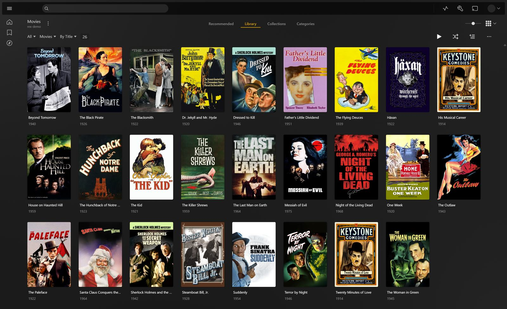
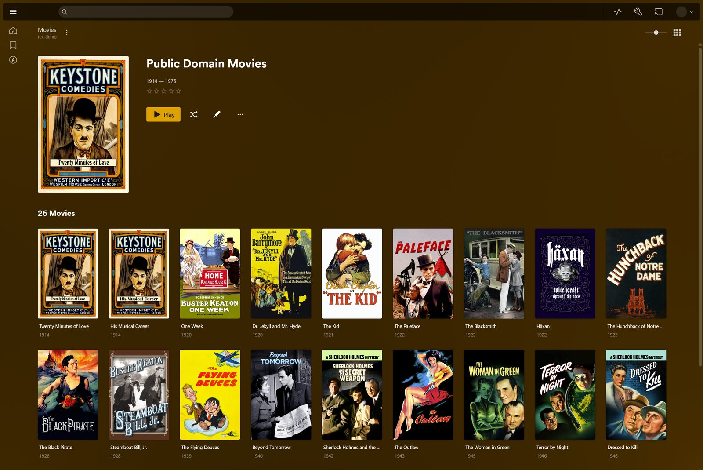
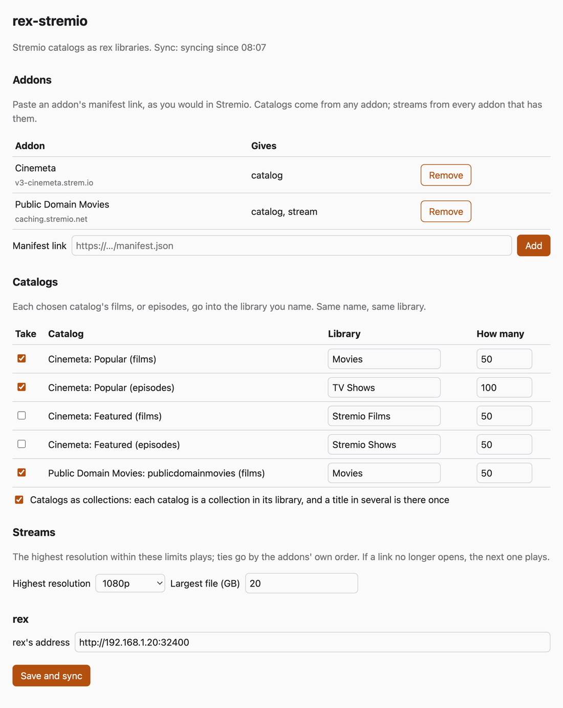
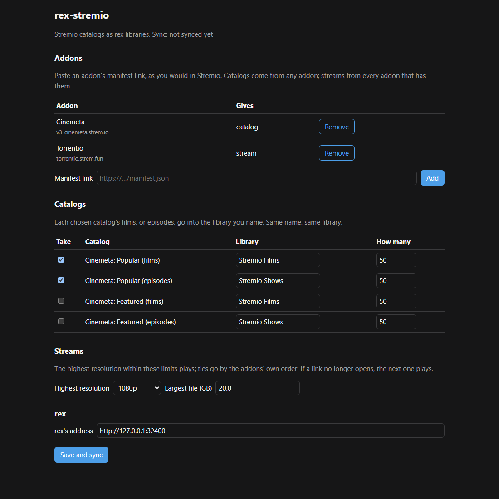

# rex-stremio

Your Stremio addons' catalogs as libraries in [rex](https://rex.debridmediamanager.com), so the
films, shows and live channels they list play in every Plex app. Nothing is downloaded: when someone presses
play, rex-stremio asks your stream addons for a link, as Stremio does, and rex plays it.

- **Add addons as in Stremio.** Paste a manifest link on the settings page. Catalogs come from
  any addon (Cinemeta, your DMM Cast list), streams from every addon that has them.
- **Plex names everything.** Each film and episode goes to rex with its IMDb id, so Plex apps
  show the usual titles, posters and summaries. The catalog's own title and poster show until
  rex is claimed. A catalog of TMDB ids is named through a meta addon (the TMDB addon by
  default); one an addon alone knows (One Pace, a site's own list) keeps the addon's names.
- **Live TV too.** A live TV addon's channels become a Live TV library, named and pictured by
  the addon, and play live.
- **You choose the quality.** The highest resolution within your limits plays (a size cap too).
  A film keeps the stream it was first checked with, and if that link stops opening, the next
  one plays.

It is one Python file (standard library only) that runs beside rex and talks to it through rex's
feed API, as every rex source does.

## Screenshots

Plex Web on a rex fed by the Public Domain Movies addon's catalog. Its films go into a Movies
library, named and pictured by Plex, and with **Catalogs as collections** the catalog is a
collection there.



<details>
<summary>The catalog as a collection</summary>



</details>

The settings page with example addons, selected catalogs and playback limits.



<details>
<summary>Dark appearance</summary>



</details>

## What you need

| You need | Why |
|---|---|
| rex, nightly 2026.10.25 or newer, claimed | A claimed rex lets Plex name each title. Setup: [rex](https://notes.debridmediamanager.com/rex/stremio/) |
| Python 3.9 or newer and `ffprobe` (part of FFmpeg) | rex-stremio checks each title's stream once with ffprobe, because rex needs to know what is in it before it can play |
| FFmpeg where rex runs, for addons that give HLS streams (`.m3u8`) | rex plays those by converting them (a copy, cheap). Files (`.mkv`, `.mp4`) need nothing |
| Stream addons that give links, not torrents | rex plays files. Set your debrid service in the addon (for Torrentio, cached results only), or use one that gives links, such as DMM Cast |
| rex-stremio on the same machine as rex, or on your home network | rex's feed answers only private networks |

## Set up

```bash
git clone https://github.com/debridmediamanager/rex-stremio
cd rex-stremio
python3 rex_stremio.py
```

Then open `http://127.0.0.1:9982/` on the same machine:

1. Paste the manifest link of each addon under **Addons** and press **Add**. For example
   `https://v3-cinemeta.strem.io/manifest.json` for catalogs, and your Torrentio link (from its
   configure page, with your debrid service) for streams.
2. Tick the catalogs you want under **Catalogs**, name the library each goes into and how many
   films, episodes or channels to take. For one library with a collection per catalog, give the
   catalogs the same library and tick **Catalogs as collections**: a film several of them list is
   in that library once, in each of their collections.
3. Set **rex's address**, for example `http://192.168.1.20:32400`, and press **Save and sync**.

The libraries show up in your Plex apps within a few minutes. rex-stremio syncs again every six
hours and after every save.

To run it as a service, copy `rex-stremio.service` to `~/.config/systemd/user/` and run
`systemctl --user daemon-reload && systemctl --user enable --now rex-stremio`. With Docker:

```bash
docker build -t rex-stremio .
docker run -d --name rex-stremio -p 192.168.1.20:9982:9982 -v "$PWD/data:/data" rex-stremio
```

Replace `192.168.1.20` with the Docker host's LAN IP. The relay is private-network software;
keep the Docker host's firewall/private-network boundary in place. Set `relay_url` in
`data/config.json` to the same LAN address (for example, `http://192.168.1.20:9982`) so rex can
reach the container (see below). If you bring an existing config into the image, set its
`listen` to `0.0.0.0:9982`; a new Docker config gets that value from the image environment.

## Settings

The page writes `config.json` (mode 600). You can also edit it yourself and restart:

| Key | Default | What it is |
|---|---|---|
| `rex_url` | `http://127.0.0.1:32400` | rex's address |
| `listen` | `127.0.0.1:9982` | Where the settings page and the relay answer. A change needs a restart |
| `relay_url` | `http://<listen>` | The address rex reads the videos from, when rex runs on another machine or in Docker |
| `source` | `stremio` | The name rex knows this source by |
| `cache` | `cache` | Where each title's stream check is kept |
| `ffprobe` | `ffprobe` | The ffprobe to use |
| `interval_minutes` | `360` | How often to sync |
| `max_resolution` | any | `2160`, `1080` or `720`: no stream above it plays |
| `max_size_gb` | any | No stream larger than this plays |
| `collections` | `false` | Each catalog a collection in its library, and a title several catalogs of one library list there once. Needs a rex whose feed takes `collections` |
| `addons` | | Each addon's manifest `url`, and its `manifest` as it was when added |
| `catalogs` | | Each catalog's `url` (`<addon>/catalog/<movie, series or tv>/<id>.json`), `library`, `limit` (default 50), `title`, and its persisted `slug`/`directory` identity |

## Limits

- Episodes come from Cinemeta and use its season and episode numbers. For a few shows these are
  not TMDB's, which rex follows, so an episode can land in the wrong place.
- A series catalog's **How many** counts episodes, not shows.
- Turning **Catalogs as collections** on or off sends its titles to rex as new items and puts
  the old ones in the trash, so what was watched on them may not carry over.
- Catalogs of types other than films, series and channels (an addon's `anime`, `channel`) are
  not listed.
- Links that need headers (an addon's `proxyHeaders`) play through rex-stremio, which then carries
  their bytes; a link that is a web page is skipped, and one rex cannot play is set aside for a day.
  An HLS link with several qualities is relayed as the best one within your limit.
- A live channel cannot be paused far back, resumed later or marked watched, and plays only in
  apps that ask rex for a conversion (Plex apps, Plezy; Plex Web is not tested). Channels the addon
  gives no working stream for, and DRM-protected ones, are left out.
- A partial or empty catalog response is kept as a partial sync: existing rex rows stay in place,
  while healthy rows from the other catalogs are still added. A later complete response can remove
  rows that really disappeared.
- Catalog slugs and directories are saved with the configuration, so reordering or editing other
  catalogs does not silently move an existing catalog's item ids. Newly selected catalogs receive
  a collision-free identity. Editing a library name updates its placement; an explicitly chosen
  directory remains a manual override.
- rex knows each title by the stream it was first checked with. If that link stops opening and
  another stream plays instead, it can differ (another codec or container) and that play can
  fail; rex-stremio then checks the new stream and tells rex at once, so the next play works.
- Catalogs that need a question first (a search, a genre) are not listed.
- Anyone who can reach `listen` can play through the relay. Keep it on `127.0.0.1` unless rex
  runs elsewhere. The settings page answers only this machine, your home network and Tailscale.
- Addon links can hold your debrid key. Keep `config.json` to yourself.

## Tests

```bash
python3 -m unittest discover -s tests
REX_BIN=/path/to/rex python3 -m unittest discover -s tests   # also syncs into a real rex
```

The fixtures are real addons' answers (Cinemeta, Torrentio over Real-Debrid, DMM Cast, Public
Domain Movies, and the live TV addons USA TV Next and PenguPlay) with keys removed.

## License

MIT

---

**More from DMM:** [Debrid Media Manager](https://debridmediamanager.com/) · [zurg](https://zurg.debridmediamanager.com/) · [rex](https://rex.debridmediamanager.com/) · [Docs](https://notes.debridmediamanager.com/) · [Sponsor](https://gatekeeper.debridmediamanager.com/) · [Discord](https://discord.com/invite/7u4YjMThXP) · [Reddit](https://www.reddit.com/r/debridmediamanager/)
